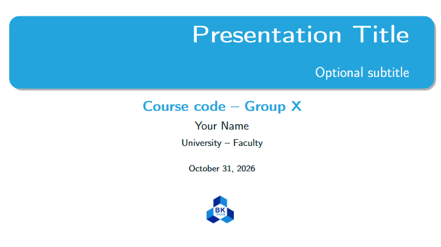
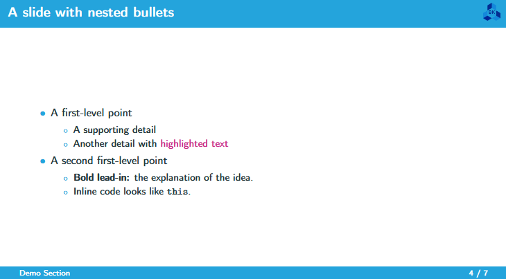
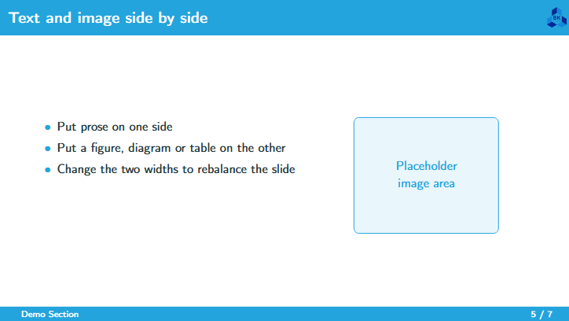

# LaTeX Beamer Template — HCMUT

A reusable 16:9 Beamer deck built on the **metropolis** theme: one brand palette
drives the whole presentation, the title slide is generated from six metadata
lines, and a component library holds every slide pattern you are likely to need.



<table>
<tr>
<td></td>
<td></td>
</tr>
</table>

## Features

- **One palette, whole deck** — title card, section dividers, frame titles,
  footer and links all follow four lines in `Preamble/branding.tex`.
- **Metadata-driven title slide** — `\title`, `\subtitle`, `\author`,
  `\institute`, `\courseline`, `\date`; leave a field empty to hide it.
- **Automatic agenda and section dividers** — each section file declares
  `\section[short]{long}`, and the agenda plus divider slides follow.
- **Footer that tells the audience where they are** — current section on the
  left, `slide / total` on the right.
- **Component cookbook** — columns, figures, tables, callouts, TikZ diagrams,
  code listings, blocks, a statement slide, a quote and a closing slide, ready
  to copy into `Sections/`.
- **Rebrand in two edits** — swap `Assets/logo.png`, change the RGB values.

## Structure

Git history and the LaTeX sources are kept apart: `.git` stays on your machine,
`deck/` is what Overleaf gets.

```
beamer-template/
├── .git/                 history only — never uploaded
├── deck.zip              generated, ready to upload (not tracked)
├── docs/                 preview images for this README
├── README.md
└── deck/                 ← THE LATEX PROJECT
    ├── main.tex          metadata + document order
    ├── COMPONENTS.tex    slide library, not part of the deck
    ├── Preamble/
    │   ├── preamble.sty  theme, packages, footer, section dividers
    │   ├── branding.tex  colours + logo path
    │   └── titlepage.tex title slide, built from the metadata
    ├── Sections/
    │   ├── 00-agenda.tex
    │   ├── 01-section.tex   demo section, replace it
    │   └── 99-thankyou.tex
    └── Assets/logo.png
```

## Quick start

1. Copy `deck/` and rename it after the project.
2. Fill in the metadata block at the top of `main.tex`:

```latex
\title{Presentation Title}
\subtitle{Optional subtitle}                        % {} hides the line
\author{Your Name}
\institute{University -- Faculty}
\renewcommand{\courseline}{Course code -- Group X}  % {} hides the line
\date{\today}                                       % or {May 1, 2026}
```

3. Write content in `Sections/` and delete the demo frames from
   `01-section.tex`.

## Writing a section

Create `Sections/02-my-topic.tex`:

```latex
\section[Short title]{Long section title}

\begin{frame}{Slide title}
    \begin{itemize}
        \item Point
        \begin{itemize}
            \item Detail
        \end{itemize}
    \end{itemize}
\end{frame}
```

and add one line in `main.tex`:

```latex
\input{Sections/02-my-topic}
```

The `[Short title]` is what the agenda, the section divider and the footer show,
so keep it under ~40 characters. Do not put `\\` inside a section title.

## Branding

Everything visual comes from four lines in `Preamble/branding.tex`:

```latex
\definecolor{BrandPrimary}{RGB}{36, 164, 220}
\definecolor{BrandAccent}{RGB}{201, 42, 135}
\definecolor{BrandDark}{RGB}{0, 33, 71}
\newcommand{\brandlogo}{Assets/logo.png}   % {} hides the logo
```

Replace `Assets/logo.png` with another organisation's logo and change the RGB
values — nothing else refers to the old brand.

## Writing

| Need | How |
|---|---|
| Image | `\includegraphics[width=0.7\linewidth]{Assets/diagram.png}` — case-sensitive, no spaces |
| Two columns | see `docs/columns.png`: two `columns` environments with `0.45`/`0.5` widths |
| Code | `lstlisting` with a language, styled once in `preamble.sty` |
| Emphasis | `\alert{...}` for the accent colour, `\textbf{...}` for weight |
| Reference | `\cite{key}` with `refs.bib` if you add a bibliography block |

Prefer the global list spacing over `\vspace{-1.5cm}` hacks.

## Build on Overleaf

1. Upload `deck.zip` — **New Project → Upload Project**.
2. Compiler **pdfLaTeX**, main document `main.tex` (it is at the project root).
3. Compile. The metropolis theme ships with TeX Live, so nothing to install.

Regenerate the zip after committing changes:

```bash
git archive --format=zip -o deck.zip HEAD:deck
```

Prefer that over Windows' `Compress-Archive`: it writes backslash separators
that Overleaf's unzip treats as literal filenames.

## Component cookbook

`deck/COMPONENTS.tex` is a scratch document showing every slide pattern that
ships with the template. Set it as the main document in Overleaf, compile, copy
the frames you want into `Sections/`, then switch the main document back to
`main.tex`. It is never part of your deck.

## Vietnamese text

Babel loads English as the main language with Vietnamese available. Occasional
Vietnamese words work with pdfLaTeX. For a mostly Vietnamese deck, switch to
**XeLaTeX** and in `Preamble/preamble.sty` replace:

```latex
% remove
% \usepackage[utf8]{inputenc}
% \usepackage[T1]{fontenc}

% add
\usepackage{fontspec}
```

## The original deck

The template was cleaned from a 91-slide database-security presentation. Git
history keeps it intact:

```bash
git log --oneline
git show 0d1b914 --stat
git archive 0d1b914 -o original-deck.zip
```

## Requirements

TeX Live 2022 or newer (Overleaf is fine). The deck needs `beamertheme-metropolis`,
`booktabs`, `tcolorbox`, `listings`, `tikz`, `multirow`, `multicol` and
`colortbl`, all in a standard full install.

## Conventions

- One idea per slide; split the slide instead of shrinking the font.
- Let the theme draw section dividers — never hand-make them.
- Put figures in `Assets/`, sections in `Sections/`, nothing else at the root.
